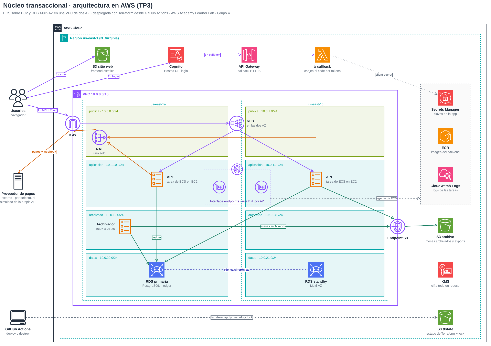
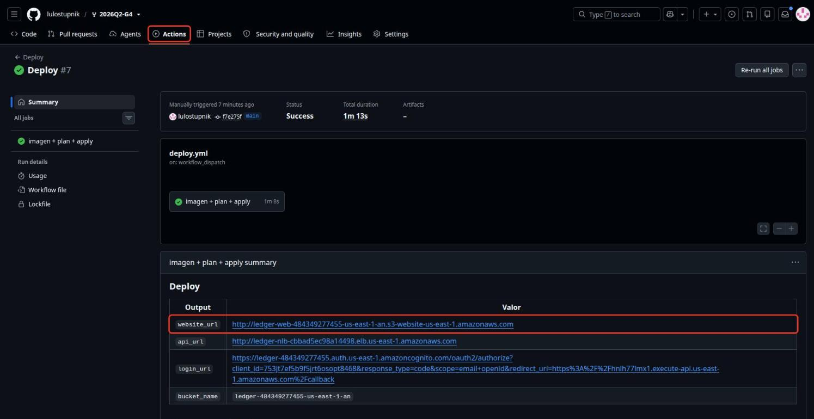
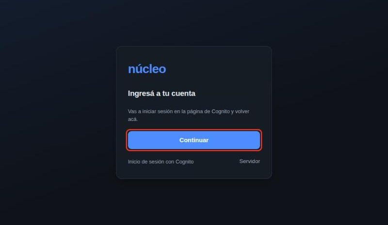
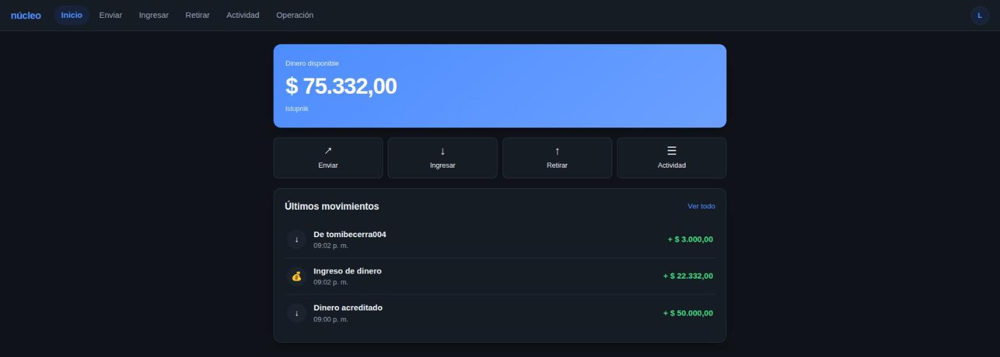
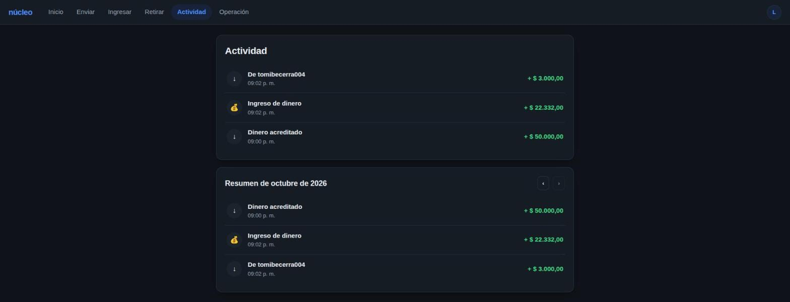
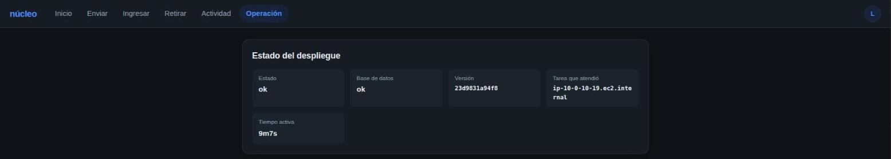

# Núcleo Transaccional Elástico — TP3 (Terraform)

Cloud Computing · ITBA · 2026Q2 · Grupo 4

Núcleo transaccional de un PSP (proveedor de servicios de pago) desplegado en AWS con Terraform.
Cada usuario tiene una cuenta virtual con la que transfiere a otras cuentas, ingresa dinero y lo
retira hacia afuera a través de un proveedor. Cada operación se liquida dentro del mismo request
contra un ledger de partida doble en PostgreSQL, y los meses viejos se archivan en S3.

El porqué de cada decisión y las correcciones de las entregas anteriores están en
[`ARCHITECTURE.md`](ARCHITECTURE.md).



**Flujo de datos:**

1. El navegador baja el frontend del bucket público de S3 y su `config.json`, que Terraform
   genera con las URL de la API y del login.
2. El login pasa por la Hosted UI de Cognito, que vuelve a un callback HTTPS en API Gateway: una
   Lambda canjea el `code` por tokens y redirige al frontend.
3. El frontend llama a la API con el access token por el NLB, que reparte entre las tareas de ECS
   de las dos AZ. La API valida el token y liquida cada operación en RDS PostgreSQL Multi-AZ.
4. Los ingresos y retiros van al proveedor por el NAT (por defecto, el proveedor simulado de la
   propia API en `/servicio-mock`).
5. Todos los días, en su ventana, el archivador mueve a S3 los meses que superan la retención.
   El extracto de un mes archivado lo arma la API leyendo S3.

Todo se despliega y se destruye desde **GitHub Actions**.

---

## Integrantes

| Nombre | Legajo |
|---|---|
| Agustín Alonso | 63316 |
| Luciano Stupnik | 64233 |
| Tomás Becerra | 63732 |
| Valentino Sanguinetti | 63098 |
| Hannah Hauge Kalager | 69482 |

---

## Prerrequisitos

**Desde GitHub Actions** (el camino recomendado) no hace falta nada instalado: alcanza con una
cuenta de AWS Academy y los secrets del paso 1. El despliegue usa `LabRole` y
`LabInstanceProfile`, que ya existen en el laboratorio.

**Desde una máquina local**, además:

| Herramienta | Versión / nota |
|---|---|
| Terraform | `>= 1.10, < 2.0` (ver [`versions.tf`](terraform/organization/versions.tf)); el pipeline usa 1.16.6 |
| AWS CLI | v2 reciente (`--bucket-namespace` en `create-bucket`) |
| Docker con `buildx` | `make imagen` construye la imagen del backend para amd64 y arm64 |
| Git | Calcula el tag de la imagen del backend (el hash de `apps/ledger`) |
| Make | Ejecuta los comandos del Makefile |
| jq | Lo usa el script que borra los buckets, y sirve para consultar los secretos |

---

## Pasos a seguir

### 1. Configurar secrets

En el repositorio, **Settings → Secrets and variables → Actions → New repository secret**:


| Secret | Para qué |
|---|---|
| `AWS_ACCESS_KEY_ID` | Access key del laboratorio de AWS Academy |
| `AWS_SECRET_ACCESS_KEY` | Secret access key del laboratorio |
| `AWS_SESSION_TOKEN` | Session token del laboratorio |

Los tres salen de **AWS Details → AWS CLI** en el laboratorio y vencen con la sesión: hay que
volver a cargarlos cada vez que se inicia el lab.

**Opcional: proveedor o webhook externos.** Sin esto, el despliegue usa el proveedor simulado de
la propia API. Para conectarlo con otro sistema (por ejemplo, el despliegue de otro equipo):

| Nombre | Pestaña | Variable de Terraform | Si queda vacío |
|---|---|---|---|
| `PROVEEDOR_URL` | Variables | `proveedor_url` | La API usa su propio `/servicio-mock` |
| `PROVEEDOR_API_KEY` | Secrets | `proveedor_api_key` | La clave del mock propio |
| `MOCK_API_KEY` | Secrets | `mock_api_key` | Se genera una |
| `WEBHOOK_URL` | Variables | `webhook_url` | La API no avisa las órdenes terminadas |
| `WEBHOOK_SECRET` | Secrets | `webhook_secret` | Se genera uno |

Desde una máquina local, los mismos valores van en `terraform/organization/terraform.tfvars` o
como `TF_VAR_*`.

### 2. Workflows


| Workflow | Cuándo corre | Qué hace |
|---|---|---|
| **Terraform** | En cada pull request, o a mano | `fmt -check`, `init` y `validate` (sin AWS); después `plan` contra la cuenta, con el resultado en el resumen del run |
| **Deploy** | A mano, escribiendo `deploy` | `make imagen` (construye la imagen y la sube a ECR), `make plan` y `make apply`. Las URL quedan en el resumen del run |
| **Destroy** | A mano, escribiendo `destroy` | `terraform destroy` y después los buckets |

Deploy y Destroy no corren nunca a la vez sobre el mismo state (`concurrency`). El apply es
manual a propósito: las credenciales del laboratorio vencen con cada sesión, y crear RDS
Multi-AZ y gastar crédito tiene que ser una decisión explícita, no un efecto de mergear.

En un pull request que viene de un fork, GitHub no le pasa los secrets al workflow: ahí el `plan`
aparece salteado (*skipped*) en lugar de fallar, y corre igual en cada Deploy. Lo mismo pasa si
el repositorio no tiene cargadas las credenciales de AWS.

Los workflows que ya traía el repositorio (`terraform-format`, `terraform-docs`, `tfsec`) corren
en cada pull request. Los README de los módulos ya están generados con terraform-docs.

### 3. Desplegar

1. **Actions → Deploy → Run workflow** → rama `main` → escribir `deploy`.

   

2. Esperar el run en verde (unos 16 minutos; RDS Multi-AZ es lo que más tarda).
3. El resumen del run tiene `website_url` (frontend), `api_url` y `login_url`.

   

**Desde otra cuenta** (por ejemplo, la de la cátedra): hace falta un repositorio propio con este
código, por ejemplo un fork, con **Actions** habilitado (en un fork nuevo GitHub lo deja apagado
hasta tocar *I understand my workflows*) y los tres secrets cargados. No hay que editar nada:
todos los nombres llevan el ID de la cuenta.

### 4. Probar

Verificar que la API responde:

```bash
curl <api_url>/health
```

Devuelve 200 aunque la base no responda: la conexión a PostgreSQL está bien si el campo `base`
es `"ok"` (si falla, es `"sin_respuesta"` y `estado` pasa a `"degradado"`).

Después, entrar por `website_url`:



1. **Ingresar** lleva a la Hosted UI de Cognito. La primera vez, **Sign up** con un email y una
   contraseña (8 caracteres, con minúsculas y números); Cognito manda un código al email. Si no
   llega, el usuario se confirma por CLI (el `user_pool_id` está en `terraform output cognito`):

   ```bash
   aws cognito-idp admin-confirm-sign-up --user-pool-id <user_pool_id> --username <email>
   ```

   

2. La primera vez pide un alias y crea la cuenta, con $ 50.000 de saldo de bienvenida que fija la
   API (`SALDO_BIENVENIDA_CENTAVOS`).
3. La billetera:
   - **Inicio**: saldo, alias y movimientos recientes.
   - **Enviar**: a quién, el monto (validado contra el saldo) y confirmación.
   - **Ingresar**: el monto y un código para el concepto de la transferencia; *Ya hice la
     transferencia* simula el aviso del banco.
   - **Retirar**: CBU o CVU de 22 dígitos, el monto y confirmación. El proveedor simulado
     rechaza los montos terminados en 13 centavos y deja *en revisión* los terminados en 99.
   - **Actividad**: mes por mes, con lo que entró y salió; un mes archivado se lee desde S3.
   - Cada operación tiene su comprobante.

   

   

   

   

4. **Operación** (estado del despliegue, proveedor activo, cierre contable, archivado, extracto
   y la cinta de llamadas a la API) aparece al activar el *Modo operación* desde el menú de la
   cuenta, con la clave de administración. Las claves están en Secrets Manager y en el navegador
   se borran al cerrar sesión:

   ```bash
   aws secretsmanager get-secret-value --secret-id ledger/api --query SecretString --output text \
     | jq '{ADMIN_API_KEY, MOCK_API_KEY}'
   ```

   

### 5. Destruir al terminar

**Actions → Destroy → Run workflow** → escribir `destroy`.


Borra todos los recursos y, si el state quedó vacío, los buckets. Sólo quedan la clave KMS, que
se borra a los 7 días, y el log group de Container Insights; ninguno molesta al próximo Deploy.

### Desde una máquina local

Con las credenciales del laboratorio en `~/.aws/credentials`, los mismos pasos que el pipeline:

```bash
make init      # crea el bucket del state si no existe e inicializa terraform/organization
make imagen    # construye apps/ledger y la sube a ECR (si ese tag ya está, no hace nada)
make plan      # deja el plan en terraform/organization/tfplan
make apply     # crea los buckets del proyecto si no existen y aplica el plan
make destroy   # pide confirmación; borra también los buckets
```

`make help` lista el resto. Local y pipeline usan el mismo state.

---

## Buckets de S3: los crea la AWS CLI

Los tres buckets del proyecto no son recursos `aws_s3_bucket`: los crea
[`scripts/buckets.sh`](scripts/buckets.sh) con `aws s3api create-bucket`, tanto en el pipeline
como desde una máquina local.

| Bucket | Lo crea | Por qué no Terraform |
|---|---|---|
| `ledger-<cuenta>-us-east-1-an` (archivo y exportaciones) | `make apply`, antes del `terraform apply` | El SCP de AWS Academy |
| `ledger-web-<cuenta>-us-east-1-an` (frontend) | `make apply`, antes del `terraform apply` | El SCP de AWS Academy |
| `ledger-tfstate-<cuenta>-us-east-1-an` (state) | `make init` | El backend lo necesita antes del `init` |

**El SCP de AWS Academy.** La política de la organización del laboratorio niega
`s3:GetBucketObjectLockConfiguration` sobre cualquier bucket. El provider de AWS hace esa
lectura cada vez que lee un `aws_s3_bucket`, después de crearlo y en cada refresh, y no tiene
ningún argumento para saltearla: el bucket se crea, pero el apply falla y el recurso queda
*tainted*. Por eso el bucket lo crea la CLI, y Terraform administra todo lo demás con los
recursos que no leen el object lock: versionado, cifrado, bloqueo de acceso público, política,
lifecycle, website y los objetos. Los módulos `storage` y `website` arman el mismo nombre que el
script (el prefijo sale de `PROJECT` en el `Makefile`, que también se pasa como
`project_name`). La cátedra aceptó esta solución para el SCP, con la condición de aclararla en el
README.

**El bucket del state** se crea aparte por otro motivo: el backend S3 tiene que existir antes de
`terraform init`, así que no puede ser un recurso del mismo state (ver
[Estado](ARCHITECTURE.md#8-estado)).

`make destroy` (y el workflow **Destroy**) borra los tres buckets con todas sus versiones, pero
sólo cuando `terraform destroy` dejó el state vacío. En una cuenta sin ese SCP, los dos buckets
del proyecto serían un `aws_s3_bucket` dentro de cada módulo y el script sólo crearía el del
state.

---

## Módulos

La raíz es [`terraform/organization`](terraform/organization): instancia los módulos y define lo
que no pertenece a ninguno: los endpoints de la VPC ([`network.tf`](terraform/organization/network.tf)),
ECR y el cluster de ECS ([`ecs.tf`](terraform/organization/ecs.tf)), los secretos
([`secrets.tf`](terraform/organization/secrets.tf)) y la clave KMS
([`kms.tf`](terraform/organization/kms.tf)). Cada módulo propio tiene su README con variables y
outputs.

| Módulo | Qué hace | Recursos |
|---|---|---|
| `terraform-aws-modules/vpc/aws` `~> 6.7` (externo) | VPC con 8 subredes en 4 capas × 2 AZ (`public`, `app`, `archive`, `data`), IGW, un NAT, una tabla de ruteo por capa y el subnet group de la base. Los CIDR se derivan en [`locals.tf`](terraform/organization/locals.tf) | Los del módulo |
| [`security_groups`](terraform/modules/security_groups) | Un SG por capa más los de los hosts de ECS y los endpoints. Las reglas salen de una sola tabla y referencian grupos o la prefix list de S3, nunca rangos | `aws_security_group`, `aws_vpc_security_group_ingress_rule`, `aws_vpc_security_group_egress_rule` |
| [`storage`](terraform/modules/storage) | Configura el bucket privado del archivo y las exportaciones: versionado, SSE-KMS, sin acceso público, sólo HTTPS y lifecycle (STANDARD_IA a los 30 días, GLACIER al año) | versionado, cifrado, bloqueo público, política y lifecycle del bucket |
| [`website`](terraform/modules/website) | Configura el bucket público del frontend: website hosting, un objeto por archivo con su `Content-Type` y el `config.json` con las URL que sólo se conocen después del apply | `aws_s3_bucket_website_configuration`, `aws_s3_bucket_policy`, `aws_s3_object` |
| [`auth`](terraform/modules/auth) | User pool de Cognito con Hosted UI y el callback HTTPS: API Gateway con `/callback` y `/logout` hacia una Lambda que canjea el `code` (ver [Login](ARCHITECTURE.md#6-login-con-cognito)). El client secret está en Secrets Manager | Cognito, `aws_secretsmanager_secret`, `aws_lambda_function`, `aws_apigatewayv2_*` |
| [`database`](terraform/modules/database) | RDS PostgreSQL Multi-AZ en `data`, cifrada y sin acceso público. Expone la `DB_URL` con TLS obligatorio | `aws_db_instance` |
| [`load_balancer`](terraform/modules/load_balancer) | NLB con listener TCP:80 y el target group de la API (targets `ip`, health check HTTP a `/health`) | `aws_lb`, `aws_lb_target_group`, `aws_lb_listener` |
| [`capacity`](terraform/modules/capacity) | Las instancias de un servicio de ECS: launch template (AMI de ECS según la arquitectura, disco cifrado, IMDSv2), ASG y capacity provider | `aws_launch_template`, `aws_autoscaling_group`, `aws_ecs_capacity_provider` |
| [`service`](terraform/modules/service) | Un servicio de ECS: task definition con los secretos como `valueFrom`, servicio con circuit breaker, log group y autoscaling por CPU o por horario | `aws_ecs_task_definition`, `aws_ecs_service`, `aws_cloudwatch_log_group`, `aws_appautoscaling_*` |

`capacity` y `service` se instancian una vez por servicio (API y archivador) con `for_each`
sobre `local.services` (ver [Cómputo](ARCHITECTURE.md#3-cómputo)).

---

## Funciones y meta-argumentos de Terraform

### Funciones utilizadas

| Función | Dónde | Para qué |
|---|---|---|
| `cidrsubnet`, `range`, `slice` | `organization/locals.tf` | Derivan los CIDR de cada capa desde el de la VPC, una subred por AZ, en las dos primeras AZ |
| `substr` | `organization/locals.tf` | La letra de la AZ en el nombre de la subred (`ledger-app-a`) |
| `floor`, `sum`, `values` | `organization/locals.tf` | Reparten `db_max_connections` entre las tareas (`pool_max_conns`) |
| `coalesce` | `organization/locals.tf` | Usa la clave o la URL de la variable o, si está vacía, la generada o la propia |
| `tostring` | `organization/locals.tf` | El puerto de la API como variable de entorno |
| `concat` | `organization/network.tf` | Asocia el endpoint de S3 a las tablas de `app` y `archive` |
| `toset` | `organization/network.tf`, `organization/secrets.tf`, `modules/auth/main.tf` | Un elemento por endpoint, por clave generada y por ruta de API Gateway |
| `replace` | `organization/network.tf`, `modules/security_groups/main.tf`, `modules/database/main.tf` | Arma nombres (`app_in_nlb` → `ledger-app-in-nlb`, la base sin guiones) |
| `try` | `modules/security_groups/main.tf` | Usa el SG de destino sólo si el `peer` de la regla es otro grupo |
| `format` | `modules/storage`, `modules/website`, `modules/auth`, `modules/database`, `modules/capacity` | Nombres de buckets, dominio de Cognito, `DB_URL` y el parámetro de SSM de la AMI |
| `jsonencode` | `organization/network.tf`, `kms.tf`, `secrets.tf` y varios módulos | Políticas de endpoints, clave y buckets, el contenido de los secretos, `config.json` y las `container_definitions` |
| `nonsensitive` | `organization/main.tf` | Recorre los nombres de las variables secretas (que no son secretos) para armar cada `valueFrom` |
| `fileset`, `filemd5` | `modules/website/main.tf` | Lista los archivos del frontend y los vuelve a subir sólo si cambiaron |
| `regex`, `lower`, `contains`, `keys` | `modules/website/main.tf` | Saca la extensión de cada archivo y publica sólo los tipos conocidos |
| `length` | `modules/website/main.tf` | Publica `config.json` sólo si hay `runtime_config` |
| `urlencode`, `join` | `modules/auth/outputs.tf` | Las URL de login y logout de la Hosted UI |
| `templatefile`, `base64encode` | `modules/capacity/main.tf` | El `user_data` de las instancias, con el nombre del cluster |
| `sort` | `modules/service/main.tf` | Las variables de entorno en orden fijo, para que el plan no muestre cambios espurios |
| `alltrue`, `can` | `organization/variables.tf` | Validan la ventana del archivador y el formato de `project_name` |

### Meta-argumentos utilizados

| Meta-argumento | Dónde | Para qué |
|---|---|---|
| `for_each` | `organization/main.tf` | `module "capacity"` y `module "service"`: la API y el archivador sin duplicar código |
| `for_each` | `organization/network.tf`, `organization/secrets.tf` | Un interface endpoint por servicio, una clave generada por uso y un secreto por servicio |
| `for_each` | `modules/security_groups`, `modules/website`, `modules/auth`, `modules/service` | Un SG por capa y una regla por fila, un objeto por archivo, una ruta por path y una acción programada por horario |
| `count` | `modules/website/main.tf`, `modules/service/main.tf` | `config.json` sólo si hay configuración, y el escalado por CPU sólo en la API |
| `depends_on` | `organization/main.tf` | Al destruir, las instancias de ECS se borran antes que los endpoints y los SG que usa su agente |
| `depends_on` | `modules/auth`, `modules/storage`, `modules/website` | El log group antes que la Lambda, y la política y el lifecycle de cada bucket después de su bloqueo público y su versionado |
| `lifecycle` | `modules/service/main.tf`, `modules/capacity/main.tf` | `ignore_changes` sobre la cantidad de tareas e instancias, que manejan el autoscaling y el capacity provider |

### Validación de variables

Los bloques `validation` limitan `archive_schedule` a 0 o 1 tarea, `log_retention_days` a los
valores que admite CloudWatch, `target_capacity` de 1 a 100 y el formato de `project_name`. Un
valor inválido falla en el `plan`, no a mitad del apply.

### Bloques `dynamic`

En `modules/storage` (una regla de lifecycle por prefijo, con sus transiciones) y en
`modules/service` (el bloque `load_balancer` sólo si el servicio tiene target group: la API sí,
el archivador no).

### Data sources

| Data source | Para qué |
|---|---|
| `aws_availability_zones` | Las AZ de la región |
| `aws_caller_identity` | El ID de la cuenta, en los nombres únicos y en las políticas |
| `aws_region` | La región, sin pasarla como variable a cada módulo |
| `aws_iam_role`, `aws_iam_instance_profile` | `LabRole` y `LabInstanceProfile`, porque AWS Academy no deja crear IAM |
| `aws_ec2_instance_type`, `aws_ssm_parameter` | La arquitectura del tipo de instancia y la AMI de ECS recomendada para ella |
| `archive_file` | El zip de la Lambda del callback |

---

## Mapa del repositorio

```
.
├── .github/workflows/     # Terraform (validate + plan), Deploy, Destroy y los que ya traía el repo
├── Makefile               # init, imagen, plan, apply, destroy, fmt, validate
├── ARCHITECTURE.md        # decisiones de diseño, trade-offs y correcciones
├── img/                   # diagrama (.png y .drawio) y capturas
├── scripts/buckets.sh     # crea y borra los buckets (state y proyecto)
├── terraform/
│   ├── organization/      # composición raíz: acá se corre terraform
│   └── modules/           # security_groups, storage, website, auth, database,
│                          # load_balancer, capacity, service
└── apps/
    ├── ledger/            # backend en Go: la API y el archivador, con su Dockerfile
    ├── web/               # frontend estático
    └── callback/          # Lambda del callback de Cognito
```
